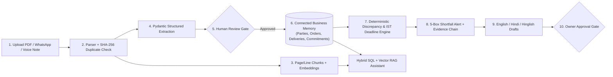

# Vyapar Memory AI — System Architecture & Interview Explanation Guide

## 1. High-Level Overview

**Vyapar Memory AI** is an evidence-based AI operations and commitment intelligence platform built for Indian wholesalers, distributors, and small manufacturers.

### Core Architectural Principle: Deterministic Rules + Grounded AI
A common pitfall in LLM applications is allowing the language model to hallucinate financial statuses or calculate quantities. Vyapar Memory AI enforces a strict separation of responsibilities:

1. **AI Layer (`backend/app/services/ai/`)**:
   - **Document & Voice Ingestion (`parser.py`)**: Extracts text from PDFs (`PyMuPDF`), CSVs, TXT/WhatsApp exports, Images (Vision OCR), and Audio voice notes (Gemini Audio / OpenAI Whisper STT) while preserving page and line numbers.
   - **Structured Extraction (`extractor.py`)**: Uses prompt-injection-safe `<UNTRUSTED_DOCUMENT_CONTENT>` delimiters and validates candidate JSON against the `StructuredDocumentExtraction` Pydantic v2 schema.
   - **Hybrid SQL + Vector RAG (`rag.py`)**: Combines exact SQL database records (`Order`, `Discrepancy`, `Commitment`, `DeliveryRecord`) with vector cosine similarity search over `DocumentChunk` embeddings.
   - **Multilingual Drafter (`drafter.py`)**: Generates follow-up message drafts in **English**, **Hindi**, and **Hinglish** referencing exact order, invoice, and challan numbers.

2. **Deterministic Business Layer (`backend/app/services/business/`)**:
   - **Discrepancy Engine (`rules.py`)**: Compares `ordered_quantity`, `invoiced_quantity`, and `delivered_quantity` using exact arithmetic (`50 - 45 = 5 boxes shortfall`), attaches verbatim document citations, and prevents duplicate open alerts.
   - **Timezone-Aware Commitment Engine (`commitments.py`)**: Evaluates deadlines in `Asia/Kolkata` (`IST`) and computes an explainable priority score (`0–100`) with a human-readable reason.
   - **Human-in-the-Loop Approval Gate (`approvals.py`)**: Ensures extracted records stay in `pending_review` until approved, and AI drafts stay in `pending_approval` until explicitly approved by an authorized user.

---

## 2. System Data Flow Diagram

---

## 3. Database Schema (16 Models in `backend/app/models/entities.py`)

| # | Model | Table Name | Purpose |
| :--- | :--- | :--- | :--- |
| 1 | `User` | `users` | Authenticated user accounts with bcrypt password hashes |
| 2 | `Workspace` | `workspaces` | Isolated business tenant workspace (`timezone="Asia/Kolkata"`) |
| 3 | `WorkspaceMembership` | `workspace_memberships` | Role-based membership (`owner`, `admin`, `staff`) |
| 4 | `Party` | `parties` | Customers and suppliers with GSTIN, phone, city |
| 5 | `Document` | `documents` | Uploaded metadata, SHA-256 hash, and extracted raw text |
| 6 | `DocumentProcessingJob` | `document_processing_jobs` | Pipeline status and active provider tracking |
| 7 | `ExtractedRecord` | `extracted_records` | Candidate JSON waiting in `pending_review` |
| 8 | `DocumentChunk` | `document_chunks` | Text chunks with page/line references and embedding vectors |
| 9 | `Order` | `orders` | Connected order tracking ordered, invoiced, and delivered quantities |
| 10 | `DeliveryRecord` | `delivery_records` | Delivery challan entries and POD confirmation status |
| 11 | `Commitment` | `commitments` | Promised delivery/payment deadlines with explainable priority scores |
| 12 | `Discrepancy` | `discrepancies` | Rule-detected shortfalls/mismatches with verbatim `evidence_refs` |
| 13 | `FollowUpTask` | `followup_tasks` | Actionable follow-up items linked to discrepancies or commitments |
| 14 | `AIDraft` | `ai_drafts` | English, Hindi, and Hinglish message drafts (`pending_approval`) |
| 15 | `ApprovalRecord` | `approval_records` | Immutable record of human approval/rejection decisions and edits |
| 16 | `AuditEvent` | `audit_events` | Workspace activity timeline for compliance and traceability |
